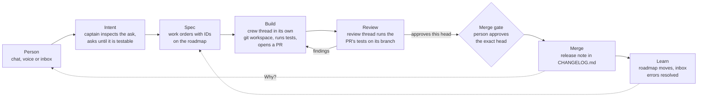

# Bob

A software factory turns a person's request into shipped code through fixed stations, and every station leaves a record. Bob is one you run by talking to its captain. The captain inspects the intent and pushes back until the request can be tested. It writes the spec as work orders with IDs on a five-stage roadmap and starts a build thread for each one. Every build thread works in its own git workspace, runs the tests, and opens a pull request. A review thread runs that PR's tests on its own branch and either sends findings back or approves the exact head. Then the person approves the merge at a gate the code enforces. The merge writes a release note, and Learn feeds the result back into the plan, including closing the production errors it fixed. Every commit, PR and message traces back to the sentence the person typed, and Why? on any PR shows that chain.



## Quick start

```bash
pnpm install
cp <your key file> .env.local     # AI_GATEWAY_API_KEY=... for the live model; without it the scripted brain runs
pnpm demo --prewarm               # checks the machine, resets to a warm seed, starts on :3000
```

[docs/DEMO.md](docs/DEMO.md) covers a fresh Mac in under 5 minutes, the 3-minute demo script, and what to do when something goes wrong mid-demo. For development, run `pnpm dev` and open http://localhost:3000.

## What's in it

- **Captain, crew and subagents.** The captain plans and talks to you. Crew threads (build, review, research) each own one work order and a branch, and a build thread can hand one focused task to a subagent. You can open any thread and type into it, or steer it, queue for it, or stop it.
- **Real workspaces.** Each thread gets its own clone of the project. `run` executes commands there with a scrubbed environment (no API keys). On Linux a user and mount namespace also confines it to that clone. The project's dependencies install once and are linked into every thread.
- **Gates in code.** A stage won't advance until its exit criteria hold. A merge needs a review that approves the current head, and then the person's approval at that same head. The message budgets stop agent loops. [docs/ARCHITECTURE.md](docs/ARCHITECTURE.md) says where each rule lives.
- **Traceability.** Commits carry `Bob-Request`, `Bob-Work-Order` and `Bob-Thread` trailers, every PR body has a trace block, and Why? follows `causedBy` back to the typed sentence. A PR that started in the inbox traces back to the quoted line of its source, such as a customer call or a production error.
- **Inbox.** Meeting notes, feedback and production errors become quoted backlog work orders, and vague asks become questions for the person. Nothing builds until you promote an order. A merge that fixes an error marks it resolved.
- **Controls.** `bob.policy.json` sets protected paths, fix rounds and budgets (below). DIGEST.md, CREW.md, NOTES.md and CHANGELOG.md are regenerated from the live state. A restart loses nothing: safe turns run again, and cut-off ones pick up from the state.

## Numbers

From [docs/perf.md](docs/perf.md), with the live model (kimi-k3.1-pro as captain, deepseek-v4.1-flash as crew):

| | Result |
| --- | --- |
| Typed sentence to merge approval, ten runs back to back | median 63 s, p90 81 s, worst 87 s; 10 of 10 completed, no failed turns, no stalls |
| The same request before the runtime work | 508 s |
| Two requests at once | both merged by 198 s, including a conflict the build thread resolved by merging main |
| `pnpm walkthrough --live` (the ten demo checks) | 10 of 10 hold, 63 s of work |

## Sponsor integrations

Each one sits behind a switch and is off by default, so Bob runs the same without its key. [docs/sponsors.md](docs/sponsors.md) has the details.

| Service | What Bob uses it for | Switch | Status |
| --- | --- | --- | --- |
| Vercel AI Gateway | Every model call, with retries and a fallback model | `AI_GATEWAY_API_KEY` | Live: every run above |
| GitHub (gh) | Publishes each PR, posts reviews with inline comments, merges at the approved head | `BOB_GITHUB=gh` | Ran live: bob#46, #49 and #51 on `demo/invoices-main` |
| Composio | The same GitHub steps through Composio's toolkit | `BOB_GITHUB=composio`, `COMPOSIO_API_KEY` | Built and unit-tested against the API docs; no key yet |
| Vercel previews | The review thread loads the PR head's preview deployment | `BOB_PREVIEWS=vercel` | Built and unit-tested; no Vercel project yet |
| HydraDB | State mirrored as a graph; Why? is one Cypher path query | `BOB_STORE=hydra`, `HYDRADB_API_KEY` | Every statement run on FalkorDB and a local HydraDB API shim; no key yet |
| ElevenLabs | Call Bob by voice; your words land in the captain's thread | `BOB_VOICE=elevenlabs`, `ELEVENLABS_API_KEY` | Built and unit-tested; browser speech works without a key |

## Proved rules

The factory rules are proved in Lean 4 under `formal/`. Conformance tests run the same scenarios against the TypeScript, so the proofs can't drift from the code without a test failing. The proofs cover these rules:

- **Merge gate.** No PR merges without the person's approval of the exact head that merged.
- **Loop termination.** Agent messages and automatic hand-offs are bounded per request, and ping-pong replies stop.
- **Stage order.** The roadmap never moves back a stage and never skips one.
- **Traceability.** Every message traces back to a person, with no cycles.

`pnpm verify` checks them. [docs/formal.md](docs/formal.md) has every theorem and the two gaps the proofs found and fixed, and `GET /api/verification` reports their status in the app.

## Agents and models

Without a key the agents decide from a script. The mailbox, the tools, the turn loop and the roadmap rules are the real ones either way; only the decision-maker changes.

To use a live model, create `.env.local` with `AI_GATEWAY_API_KEY` set and restart. The sidebar footer shows which one is active.

```
AI_GATEWAY_API_KEY=...
BOB_MODEL_STRONG=moonshotai/kimi-k3.1-pro
BOB_MODEL_LIGHT=deepseek/deepseek-v4.1-flash
```

`BOB_MODEL_STRONG` is the captain's model and `BOB_MODEL_LIGHT` is every crew thread's. A Vercel Token Pass key can only call Token Pass models: `moonshotai/kimi-k3.1-pro`, `moonshotai/kimi-k3`, `moonshotai/kimi-k3-fast`, `zai/glm-5.3-fast`, `zai/glm-5.3-flash`, `deepseek/deepseek-v4.1-flash` and `deepseek/deepseek-v4.1-flash-fast`. After changing models, `POST /api/reset` reseeds the team so stored threads pick them up. `BOB_PROJECT_REPO` brings in your own repository in place of the invoices template.

## Factory policy

A project can put `bob.policy.json` at the root of its main branch. Every field is optional, and anything left out keeps its default:

```json
{
  "approvalPaths": ["package.json", "**/*.lock", ".github/**"],
  "maxFixRounds": 2,
  "budgets": { "maxMinutes": 3, "maxModelCalls": 60, "maxCostUsd": 1 },
  "prices": { "moonshotai/kimi-k3.1-pro": [0.6, 2.5] }
}
```

`approvalPaths` are named on the merge approval whenever a pull request touches them. `maxFixRounds` caps the review-fix loop. A request that goes over a budget gets an alert line in DIGEST.md. `prices` are dollars per million input and output tokens, and they feed the cost estimate shown for each request.

## Checks

```bash
pnpm typecheck && pnpm test && pnpm build
pnpm walkthrough            # the ten demo checks, scripted brain; --live for the model
pnpm verify                 # Lean proofs and conformance tests
```

## Docs

- [docs/DEMO.md](docs/DEMO.md): running the demo
- [docs/ARCHITECTURE.md](docs/ARCHITECTURE.md): the pieces, how a message travels, and where each gate is enforced
- [docs/perf.md](docs/perf.md): build loop timings and how to measure them
- [docs/formal.md](docs/formal.md): the proofs
- [docs/sponsors.md](docs/sponsors.md): each integration, its switches and how it was tested
- [docs/history/PLAN.md](docs/history/PLAN.md): the plan written before the build, kept for the record
