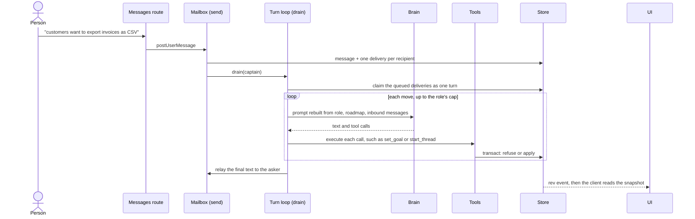
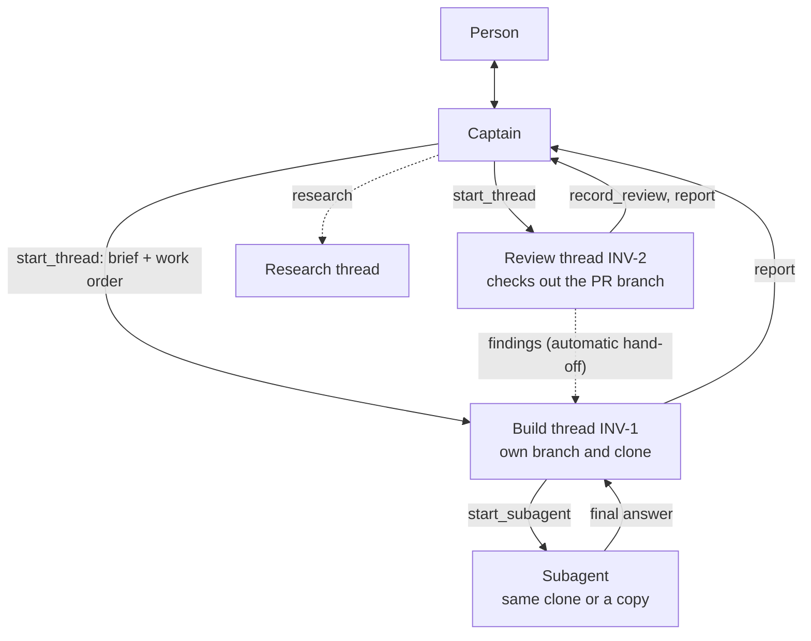
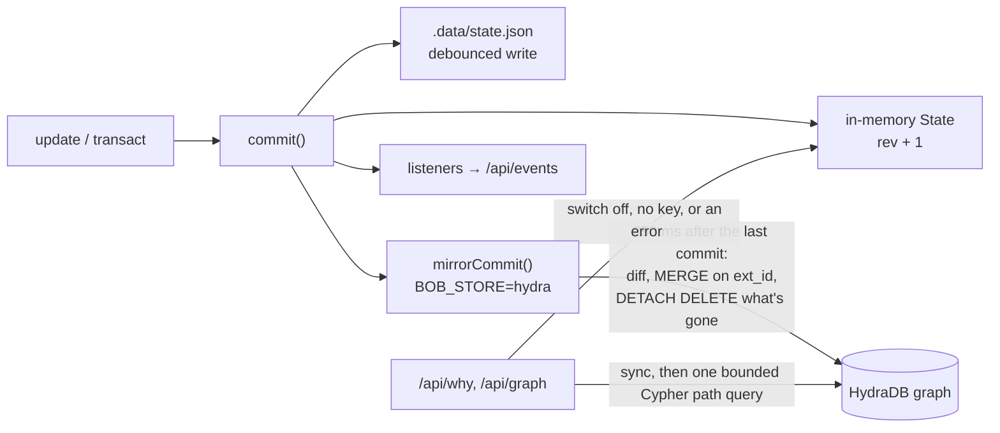

# Architecture

Bob is one Next.js 16 app. The UI is React 19 under `src/components/`. The runtime is plain TypeScript under `src/lib/`, and the API routes under `src/app/api/` are thin: each one validates its body in `src/lib/http.ts` and calls one function in `src/lib/actions.ts` or a feature module. The shared shapes, and the list of every route, are in `src/lib/types.ts`.

## The pieces

| Piece | What it does | Where |
| --- | --- | --- |
| Store | One in-memory `State`, changed only through `update` and `transact`, saved to `.data/state.json` and mirrored to HydraDB | `store.ts`, `state.ts`, `state-ops.ts` |
| Mailbox | Messages, with one delivery per recipient, reply rules and budgets | `mailbox.ts`, `asks.ts` |
| Turn loop | Claims an agent's queued deliveries as one turn, runs the brain move by move, executes tool calls | `turns.ts`, `turn-start.ts`, `turn-context.ts` |
| Relay | Sends a turn's final text back to whoever asked, as the answer | `relay.ts`, `reply-format.ts` |
| Brain | Picks the next move: a live model through the Vercel AI Gateway, or a script with the same tools | `brain/model.ts`, `brain/script*.ts`, `brain/prompt.ts` |
| Tools | What each kind of agent may call, by tool set (`captain`, `build`, `review`, `research`, `subagent`) | `tools/*-defs.ts`, `tools/define.ts` |
| Roadmap | Goal, five stages with exit criteria, backlog and today's work orders | `roadmap.ts`, `stages.ts`, `tools/planning.ts` |
| Workspaces | A bare origin per project, one clone per thread, a shared dependency install, the `run` shell | `workspace/`, `thread-workspace.ts` |
| Pull requests | Open, review, approve, merge, release note | `tools/pull-requests.ts`, `tools/handoff.ts`, `tools/work.ts`, `release-notes*.ts` |
| Trace | `causedBy` chains, commit trailers, the PR trace block, Why? | `why.ts`, `trace.ts`, `graph/view.ts` |
| Inbox | Raw materials triaged into quoted backlog work; Learn resolves errors on merge | `inbox.ts` |
| Restart | The boot sweep: reruns safe turns, picks up cut-off ones from the state | `boot.ts` |
| Sponsors | GitHub and Composio, Vercel previews, HydraDB, ElevenLabs, each behind a switch | `integrations/`, `graph/`, `voice/` |

## How a message travels



1. **The person's message.** `postUserMessage` in `actions.ts` calls `send` in `mailbox.ts`. The mailbox validates the message (the recipient exists and isn't closed, the reply rule, the budget), records it with its `causedBy`, and queues one delivery per recipient. Then it wakes each recipient with `drain`.
2. **One turn per agent at a time.** `planTurn` in `turn-start.ts` claims every queued delivery of an idle agent in one update. A message sent to a busy agent waits for the next turn, or, with `mode: "steer"`, lands inside the running one.
3. **Moves.** `turns.ts` asks the brain for a move up to a cap: 12 for the captain, 24 for a build thread, and 12 for review and research. The prompt is rebuilt every move from the agent's role, the live roadmap and the inbound messages. Anything the person didn't just type goes in as JSON data (`framing.ts`). Text and started tool calls stream into `state.live` while the model writes them.
4. **Tools.** Each call runs against the store in `transact`, so the check and the change happen in one step. A refusal goes back to the model as a plain instruction, such as "Merging #1 needs the person's approval first ...". For the captain, `autopilot.ts` runs the steps its rules already fix before the first model call: an approved merge card merges and closes its threads, and an approving review gets its approval card.
5. **The answer.** When the turn ends, `relay.ts` sends its final text to whoever asked, as a reply. Replies between agents use the Status / Result / Evidence shape. A crew thread's reply to the captain wakes the captain's next turn.
6. **The UI.** Every commit bumps `rev`. `/api/events` pushes it over server-sent events, and the client reads `/api/state` (`snapshot.ts`).

Every message a tool sends sets `causedBy` to the message its turn is handling, and `traceWhy` follows that back to the person. A thread brief for an inbox work order is caused by the inbox message instead, so Why? ends at the quoted line and its source.

## Captain, crew and subagents



- **The captain** is the only agent the person talks to by default. It inspects the request (at most two rounds of questions, `brain/intake.ts`), writes the goal and work orders, starts and closes crew threads, asks for approval and merges. Its tools are in `tools/captain-defs.ts`.
- **Crew threads** have a role: build, review or research (`crew.ts`). Each belongs to the one request it was started for, carries a work order, and has its own branch and clone. At most 3 work at once (`MAX_BUSY_THREADS`), and the captain can't start a second open thread of the same role for the same work order. A build thread writes, runs, commits and opens the PR. A review thread starts with the PR's branch checked out and its full diff, runs its tests, and records a verdict.
- **Subagents** take one focused task from a crew thread (`subagents.ts`). A thread may have 2 open at a time, and a subagent can't start its own. It works in its parent's clone (`same`) or a copy, and its final answer goes to the parent alone.
- **The review loop runs itself** (`tools/handoff.ts`). Findings go to the build thread, and a new head goes back to the last reviewer. A branch that conflicts after another merge goes to its owner to merge main. These hand-offs are sent for the captain and spend a separate budget.

## Store and the HydraDB mirror



The JSON store is the source of truth. State code is synchronous pure functions over one object, so the graph is a write-through mirror added by one line in `commit`, and it can't lose state when HydraDB is slow. `graph/schema.ts` projects the state into nodes and edges, with Bob's id in `ext_id`, and `graph/mirror.ts` sends only what changed. `/api/why` and `/api/graph` sync first, answer from the graph when they can, and report `source: "hydra" | "memory"`. [sponsors.md](sponsors.md) has the full schema and the Why? query.

## The gates, and where each is enforced

| Gate | Rule | Enforced in |
| --- | --- | --- |
| Intent | The roadmap can't leave Intent until the goal names a user, the behaviour they need and an acceptance check. The captain asks at most two rounds of questions, then goes on with stated assumptions. | `advanceStage` in `roadmap.ts` against the criteria in `stages.ts`. The question limit is `MAX_PUSHBACK_ROUNDS` in `brain/intake.ts`. |
| Stage order | Each stage advances by exactly one, only when its exit criteria hold, and never goes back. | `advanceStage` and `unmetCriteria` in `roadmap.ts` (proved in `formal/BobFormal/Roadmap.lean`) |
| Work orders | At most three in today. A thread's work order must be in today. One open thread per role and work order. | `setToday` in `roadmap.ts`; `startRefusal` in `tools/threads.ts` |
| Inbox | Nothing from the inbox starts on its own: `start_thread` is refused inside an inbox triage request. Every candidate must quote the item exactly. | `startRefusal` in `tools/threads.ts`; `triageInbox` in `inbox.ts` |
| Workspace | Commands run in the thread's clone with no API keys. On Linux a user and mount namespace makes the system read-only and hides Bob's data, env files and every other workspace. | `shellEnv` and `sandboxScript` in `workspace/shell.ts` |
| Git | Agents run only allowed git subcommands and options, and reach only origin. Origin refuses force-pushes, branch deletes and any push to `main`, so `main` changes only through an approved merge. | `checkGitArgs` in `workspace/git-policy.ts`; `receive.denyNonFastForwards`, `receive.denyDeletes` and the pre-receive hook in `workspace/setup.ts` |
| Review | The approval card needs a review that approves the PR's current head. A new head goes back to review. | `reviewGateRefusal` in `tools/handoff.ts`, called from `requestApproval` in `tools/work.ts` |
| Merge | A merge needs the person's approval of the exact head that merges. Only the person's decision approves. | `approvalRefusal` in `tools/pull-requests.ts`; `decideApproval` in `actions.ts` (proved in `formal/BobFormal/MergeGate.lean`) |
| Protected paths | Files that `bob.policy.json` lists are named on the approval card. | `withProtectedNote` in `tools/work.ts`, `policy.ts` |
| Loops | Agents start at most 12 deliveries per request, and hand-offs at most 24. A reply must answer an unanswered ask. A build thread gets two fix rounds. Every turn has a move cap. | `send` and `overBudget` in `mailbox.ts` (proved in `formal/BobFormal/Mailbox.lean`); `MAX_FIX_ROUNDS` in `tools/handoff.ts`; the caps in `turns.ts` |
| Budgets | A request over its time, call or cost budget gets an alert in DIGEST.md. | `usage.ts`, `policy.ts` |

After a merge, `markMerged` completes the work order, `recordReleaseNote` writes the release note to CHANGELOG.md and the Learn card, and `resolveOnMerge` marks inbox errors in the changed files as resolved. All three are called from `mergePullRequestTool` in `tools/pull-requests.ts`.

## Workspaces on disk

```
.data/workspaces/<project>/
  origin.git/      bare repository, the project's main; refuses force-pushes, deletes and pushes to main
  deps/            a checkout of main where the dependencies are installed once
  home/            HOME for every command and git call
  agents/<id>/     one clone per thread, on its own branch; node_modules linked from deps/
```

`ensureProject` makes the origin from the invoices template or `BOB_PROJECT_REPO`. `ensureWorkspace` clones it for one thread. `prepareProjectDeps` installs with the repository's lockfile, and `ensureWorkspaceDeps` hard-links that install into each clone (an APFS clone on macOS). `mergePullRequest` in `workspace/pull-request.ts` updates main in the origin directly: a fast-forward when it can, else a merge commit, and it refuses a conflicting branch. A conflict goes back to the build thread, which merges main into its branch before the head is reviewed again.

## Restart

`boot.ts` sweeps the saved state when the server loads. A turn the restart cut off reruns when every step it took is safe to repeat. Otherwise it picks up from the state with a notice of what already happened, so nothing runs twice. Askers whose answer was lost get one, and queued work starts again.
